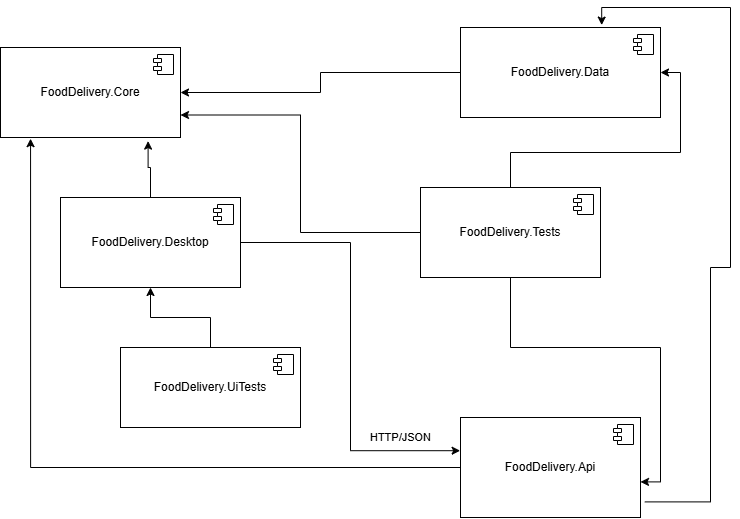
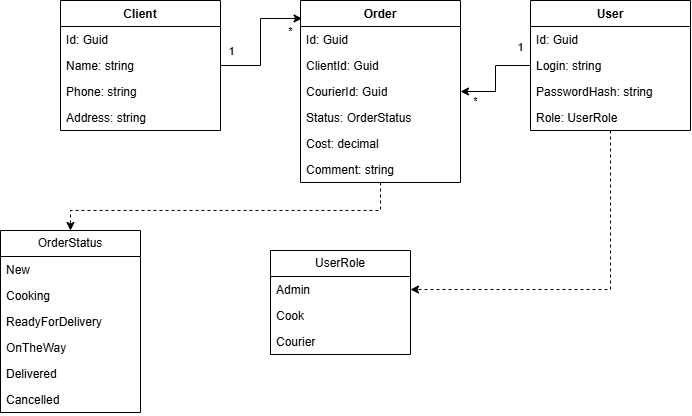

Таблица модулей:
| Модуль | Тип проекта | Ответственность | Зависит от |
| :--- | :--- | :--- | :--- |
| FoodDelivery.Core | Библиотека классов | Сущности, правила, сервисы, DTO, интерфейсы, обмен данными, журнал клиента | — |
| FoodDelivery.Data | Библиотека классов | EF Core: контекст, миграции, репозитории, начальные данные | Core |
| FoodDelivery.Api | Веб-API ASP.NET Core | HTTP-интерфейс, авторизация, обработка ошибок, журнал сервера | Core, Data |
| FoodDelivery.Desktop | Приложение WPF | Окна пользователя, клиент REST API | Core |
| FoodDelivery.Tests | Тесты xUnit | Модульные и интеграционные тесты | Core, Data, Api |
| FoodDelivery.UiTests | Тесты xUnit + FlaUI | Автотесты интерфейса | собранный Desktop.exe |

Правила зависимостей:
1. Core ни на что не ссылается.
2. Desktop не ссылается на Data — данные он получает только через API.
3. Циклические ссылки между проектами запрещены.

Структура папок проекта:
FoodDelivery/
- docs/                 документы этапа 1
- FoodDelivery.Core/
   - Entities/          Client, Order, User, перечисления, правила статусов
   - Contracts/         DTO и сопоставление сущностей с DTO
   - Interfaces/        интерфейсы репозиториев
   - Services/          бизнес-логика
   - Security/          хеширование паролей
   - Exchange/          импорт и экспорт данных
   - Exceptions/        исключения предметной области
   - Logging/           журнал клиентского приложения
- FoodDelivery.Data/AppDbContext, Repositories/, Migrations/
- FoodDelivery.Api/Controllers/, Infrastructure/, Program.cs
- FoodDelivery.Desktop/окна *.xaml, Services/, Converters/
- FoodDelivery.Tests/Unit/, Integration/, Fakes/
- FoodDelivery.UiTests/

Таблица интерфейсов:
| Интерфейс (модуль Core) | Методы | Кто реализует | Кто использует |
| :--- | :--- | :--- | :--- |
| IClientRepository | GetAllAsync, GetByIdAsync, GetByPhoneAsync, AddAsync, AddRangeAsync | Data | сервисы Core |
| IOrderRepository | GetAllAsync(OrderFilter), GetByIdAsync, AddAsync, UpdateAsync | Data | сервисы Core |
| IUserRepository | GetAllAsync, GetCouriersAsync, GetByIdAsync, GetByLoginAsync, AddAsync | Data | сервисы Core, Api |
| IPasswordHasher | HashPassword, Verify | Core | AuthService, начальные данные |

